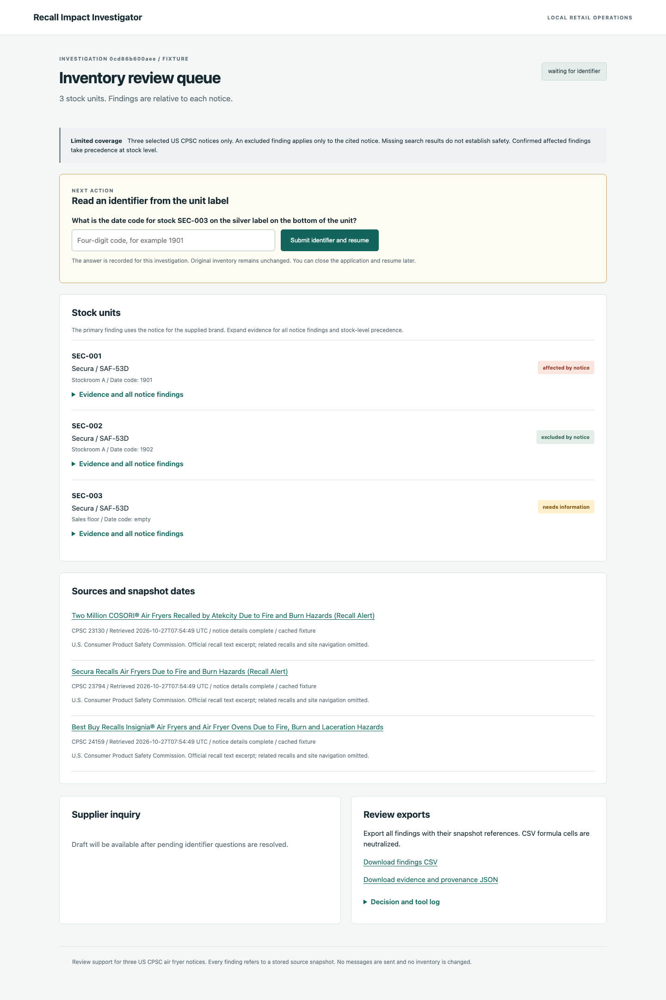
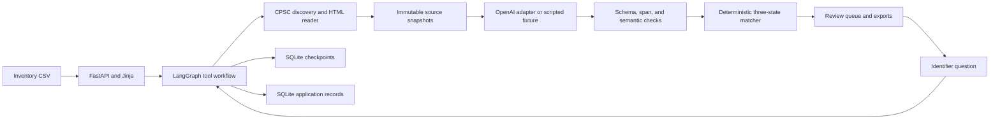

# Product Recall Impact Investigator

A local review tool for a small retailer: upload one inventory CSV, compare stock units with three official US CPSC air fryer notices, inspect cited evidence, answer a missing identifier question, and export a draft supplier inquiry. It never sends messages or changes inventory.

**Verification status:** the deterministic application, browser restart/resume journey, and container fixture workflow have been executed. Live CPSC retrieval passed for all three notices. Live OpenAI extraction and clarification remain unverified because no API key was configured during delivery. Scripted results below do not measure model quality.



## Run locally

Requires Python 3.12, [uv](https://docs.astral.sh/uv/), and make. Setup installs the locked dependencies and Chromium for the browser test.

```sh
git clone https://github.com/AntarangSharma/recall-impact-investigator.git
cd recall-impact-investigator
make setup
make demo
```

If port 8000 is occupied, use `make demo PORT=8765` and open that port.

Open [localhost:8000](http://127.0.0.1:8000) and select **Open fixture demo**. No API key is needed. To get a fresh, isolated demo after an earlier run:

```sh
RECALL_RUNTIME=/tmp/recall-interview-demo make demo
```

The demo uses `SAF-53D`: stock SEC-001 has `1901`, SEC-002 has `1902`, and SEC-003 has an empty code. The first is affected by Secura notice 23-794, the second is excluded by that notice, and the third needs information. Enter `1901` for SEC-003 to resume. The original uploaded inventory stays unchanged; the answer is a separate investigation record. See [the three-minute demo](docs/demo.md).

## Fixture and live modes

Fixture mode loads immutable stored notice snapshots and **explicitly scripted extraction and tool-choice responses**. It is reproducible and is not an LLM simulation presented as live inference.

Live mode uses CPSC API discovery, fetches the official HTML details, and calls the official OpenAI Python SDK through `src/recall/llm.py`. Configure a key locally, never in a commit or chat:

```sh
cp .env.example .env
# Edit .env locally and set OPENAI_API_KEY. OPENAI_MODEL is configurable.
make eval-live
make smoke-live
```

The default model is `gpt-4.1-mini`. An external environment file can be selected with `RECALL_ENV_FILE=/absolute/path/to/private.env`. `make demo` remains a fixture workflow; select Live in the upload form to use inference in the UI. Live inventory identifiers and validated findings are sent to OpenAI for tool selection and constrained narrative generation. Keep real private inventory out of a public repository.

Budgets persist per investigation across restarts: 18 calls, $2 estimated reservation, 180 seconds of aggregate model-request time, no automatic SDK retries, and a 30-second maximum request timeout. Extraction output is capped at 3,500 tokens; tool choices at 300; draft output at 1,200. Accounting rates default to conservative configurable ceilings of $10/$40 per million input/output tokens, not a vendor price quote. A reservation includes serialized schema/input bytes and maximum output tokens. Failed attempts retain their reservations. Very large inventories can exceed the draft budget and show an explicit failure while retaining reviewable findings.

The model chooses among evidence-eligible tools: `search_notices`, `read_notice`, `lookup_inventory`, `request_identifier`, and `draft_inquiry`. Deterministic gates constrain available tools. The model can choose notice inspection order and which pending identifier to resolve; it cannot bypass unresolved identifiers or alter matching results. Explanations and inquiries use constrained language choices derived from validated facts. Invented facts, altered statuses, and unsupported explanatory claims are rejected.

## Design



The main boundaries are small: identifier/criteria types, CSV handling, source retrieval, rule validation and matching, SQLite storage, one model adapter, one graph, and one web module. There are no embeddings, vector search, OCR, crawlers, queues, or extra services. The SQLite checkpoint package installs `sqlite-vec` transitively; this application never loads it or creates a vector database.

CSV columns are `stock_id,brand,model,location` plus optional `date_code,serial_number`. One row identifies one stock unit. Fields are strings. Absent optional columns, explicit empty cells, and malformed values are distinct. Uploads are limited to 1 MB, 1,000 rows, and 200 characters per cell. Structural row errors reject the upload atomically; identifier errors remain visible and produce uncertainty. CSV exports prefix spreadsheet formula cells with an apostrophe.

Finding states are `affected_by_notice`, `excluded_by_notice`, and `needs_information`. An exclusion requires complete reviewed source coverage and supported criteria for that specific notice. A model absent from this three-notice subset is not proof of safety. Affected findings take precedence at stock level, while every notice finding remains visible. Brand conflicts, invalid identifiers, unsupported rules, stale source versions, and retrieval failures cannot produce unsupported exclusions.

## Measured evaluation

The 60 scenarios are clearly labeled synthetic examples, not customer inventory. Gold labels, rationales, and criteria are specified independently of matching in `evals/scenarios.json` and `evals/gold_criteria.json`. There are 21 affected, 21 excluded, and 18 insufficient-information cases. Insignia and its 20 scenarios were reserved before the extraction prompt was authored. It was inspected for independent gold preparation, so this is a prompt-tuning holdout, not a blind benchmark. The prompt has not been tuned on held-out inference results.

| Measurement | Exact model baseline | Fixed gold criteria | Scripted extraction pipeline |
|---|---:|---:|---:|
| Correct classifications | 41/60 | 60/60 | 60/60 |
| Affected recall | 21/21 | 21/21 | 21/21 |
| Affected precision | 21/37 | 21/21 | 21/21 |
| Incorrect exclusions / predicted exclusions | 3/19 | 0/21 | 0/21 |
| False model matches / near-model negative cases | 0/15 | 0/15 | 0/15 |
| Correct required-field requests | 0/10 | 10/10 | 10/10 |
| Held-out Insignia correct | 16/20 | 20/20 | 20/20 |

Baseline: case-normalized exact identifier token lookup in the notice, ignoring code constraints, incomplete-source flags, and clarification. It preserves suffix boundaries. The reported gain therefore comes mainly from source restrictions and uncertainty handling, not from weakening the baseline with fuzzy matches.

Confusion counts, actual rows by predicted columns:

| Method / actual | Affected | Excluded | Needs information |
|---|---:|---:|---:|
| Fixed criteria / affected | 21 | 0 | 0 |
| Fixed criteria / excluded | 0 | 21 | 0 |
| Fixed criteria / needs information | 0 | 0 | 18 |
| Baseline / affected | 21 | 0 | 0 |
| Baseline / excluded | 5 | 16 | 0 |
| Baseline / needs information | 11 | 3 | 4 |

Scripted extraction matches 21/21 exact field groups and has 11/11 valid rule/alias citations. Held-out scripted extraction is 7/7 field groups with 1/1 citation. The seven groups per notice are brand, exact model set, aliases, model/code associations, completeness, unsupported conditions, and operators. Each group uses exact equality, including extra or omitted values. Valid quotes alone do not pass field correctness. Raw live extraction is scored before acceptance checks; rejected extraction cannot enter end-to-end matching.

**Live supported-field correctness is not measured yet.** The target of at least 90% live correctness has not been established. [Fixture results](evals/results-fixtures.json), [retrieval results](evals/results-retrieval.json), [live status](evals/results-live.json), and [live smoke status](evals/results-live-smoke.json) contain explicit denominators and verification limits. Sixty synthetic cases and one held-out notice are too small to establish production reliability.

## Commands and verification

| Command | Purpose / observed result |
|---|---|
| `make setup` | Locked Python 3.12 environment and Chromium; passed |
| `make demo` | Starts the three-row fixture investigation and local web server |
| `make test` | pytest, API/database integration, separate-process resume, and real Chromium journey |
| `make check` | Ruff format, lint, strict mypy, and forbidden-character scan; passed |
| `make eval-fixtures` | Full 60-case baseline and structured comparison; passed |
| `make eval-live` | Live retrieval and extraction on all three notices; stopped explicitly without a key |
| `make smoke-live` | Live tool selection, retrieval, clarification, restart/resume; stopped explicitly without a key |
| `make refresh-data` | Live API discovery and HTML retrieval for all three notices; passed |

[Verification details](docs/verification.md) record actual test counts and execution. CI runs deterministic checks, the real browser test, and Docker fixture verification with no API secrets.

```sh
docker build -t recall-impact-investigator:local .
docker run -d --name recall-local -p 127.0.0.1:8000:8000 recall-impact-investigator:local
docker exec recall-local python scripts/container_smoke.py
docker exec recall-local python -m recall.cli eval-fixtures
docker rm -f recall-local
```

The container runs as a non-root user. Mount a writable volume at `/app/runtime` to retain investigations across container replacement. The initial image build, health check, clarification/resume, nine-row export, and fixture evaluation were executed successfully. A clean temporary Git checkout also passed setup, checks, and tests.

## Source coverage and limits

- [Secura, September 28, 2023, 23-794](https://www.cpsc.gov/Recalls/2023/Secura-Recalls-Air-Fryers-Due-to-Fire-and-Burn-Hazards-Recall-Alert): model-specific date-code sets and parenthetical aliases.
- [Cosori, February 23, 2023, 23-130](https://www.cpsc.gov/Recalls/2023/Two-Million-COSORI-Air-Fryers-Recalled-by-Atekcity-Due-to-Fire-and-Burn-Hazards): 21 exact model identifiers.
- [Insignia, March 14, 2024, 24-159](https://www.cpsc.gov/Recalls/2024/Best-Buy-Recalls-Insignia-Air-Fryers-and-Air-Fryer-Ovens-Due-to-Fire-Burn-and-Laceration-Hazards): six exact fryer/oven models.

Source text is attributed to the U.S. Consumer Product Safety Commission. Stored normalized excerpts retain recall descriptions, remedy details, recall numbers, provenance, and raw/source SHA-256 hashes. Navigation and unrelated recalls are omitted. No CPSC endorsement is implied. Consult the original linked notice for official instructions. This tool drafts a supplier inquiry rather than applying a remedy itself.

Snapshots were retrieved on October 27, 2026 UTC. Cache age over 24 hours is labeled in the UI. New source versions invalidate prior derived findings and drafts. Changed source content requires a reviewed profile before new exclusions; refresh stages versions in `runtime/refreshed` without overwriting committed fixtures. A failed refresh preserves previous evidence and findings.

Only validated HTTPS CPSC recall paths and its [documented saferproducts.gov API](https://www.cpsc.gov/Recalls/CPSC-Recalls-Application-Program-Interface-API-Information) are fetched. Redirects are checked before each request; no supplier links or instructions inside notices are followed. Retrieval has response-size, elapsed-time, and timeout limits. CPSC returned 403 for the custom application User-Agent during testing; the tested HTTP compatibility header is documented in the source reader.

Date codes are opaque strings, not calendar dates. Sale periods are not manufacturing constraints. Numeric fixed-width serial ranges are supported by the rule engine; these three notices do not require serial ranges. Other serial formats remain unresolved. This local single-process application has no authentication or multi-user access controls; keep its server bound to localhost. Broad source discovery, recall images/PDFs, OCR, international notices, supplier messaging, inventory updates, and general safety clearance are out of scope.

Development used AI assistance. The repository demonstrates an implemented workflow and measured synthetic evaluation, without claiming independent authorship, real users, business savings, or production history. [Engineering notes and interview questions](docs/engineering.md) explain the constraints and tradeoffs.
